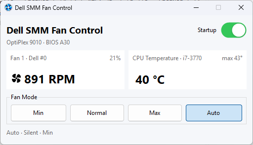

# Dell SMM Fan Control


A compact Windows fan-control utility for Dell OptiPlex case swaps. It uses
Dell's SMM interface to control the remaining fans, monitor CPU temperature
and keep cooling quiet with a CPU-based automatic curve.

Intended for projects that move OptiPlex 7010, 9010 and similar motherboards
into standard cases, leaving out the original front panel, external ambient
temperature sensor or second chassis fan. The app controls cooling in Windows
using CPU temperature; it does not need those missing peripherals for its own
control logic. It does not modify BIOS, bypass POST checks or remove F1 prompts.

**Known working hardware:** Dell OptiPlex 9010 SFF, BIOS A30, board 03JR84,
Intel Core i7-3770. Other models and BIOS versions are unverified.
An available SMM interface does not guarantee compatibility.
OptiPlex 7010 and other models are candidates for compatibility testing, not
confirmed supported hardware.



## Features

- Min, Normal, Max and Auto modes, applied to all detected running fans.
- Up to two fan channels, each with RPM and percentage of its nominal maximum.
  Channels reporting zero or unavailable RPM are hidden.
- CPU temperature, processor model and highest CPU temperature since launch.
- Computer model and BIOS version in the main window.
- Minimize to tray; single-click the tray icon or launch again to restore.
- Tray tooltip with current mode, RPM and CPU temperature.
- Startup toggle using a per-user Windows Task Scheduler task.
- Reconnect to the SMM driver after sleep/resume.

The animated fan is illustrative (1, 2 or 3 turns per second), not a physical
representation of the fan's RPM.

## Requirements and compatibility

- Windows x64 and a compatible Dell motherboard/firmware.
- Administrator permission to load the bundled kernel driver.
- Permission from Windows security policy to load that driver.

The application uses the unmodified signed `bzh_dell_smm_io_x64.sys` driver,
bundled beside the executable. SpeedFan, PawnIO and Dell utilities are not needed.
The self-contained portable package does not require installing .NET separately.

This is a community hardware-control utility. Firmware behavior varies by model.
Windows can block the legacy driver even though it is signed. A blocked driver
is a compatibility limitation; this project does not require disabling Windows
security protections. Avoid running another fan-control utility at the same time.

## Running

1. Download a portable ZIP from this repository's Releases page when available.
2. Extract the **entire** archive into a permanent folder. Keep the `.sys` file
   beside `DellSmmFanControl.exe` and retain the license/source files.
3. Run `DellSmmFanControl.exe` and accept the UAC prompt.
4. Choose a mode. Auto is the default; the last selected mode is saved.

Minimizing hides the window in the notification area. Click its icon once to
restore it. The window's close button and the tray's **Exit** command both exit
the application and attempt to return cooling control to BIOS.

Enable **Startup** to create a task for the current Windows account. It starts
the app about 10 seconds after sign-in, elevated and hidden in the tray.
If you move the application, launch it from the new folder and enable Startup
again to update the saved path. Disable Startup before deleting the app.

Settings: `%LOCALAPPDATA%\DellFanControl\settings.json`. This legacy directory
name is retained for compatibility. Startup task names and the temporary driver
service also retain the earlier `DellFanControl` identifier.

## Fan modes

| Mode | Behavior |
| --- | --- |
| Min | Lowest firmware level confirmed to keep the fan running |
| Normal | Middle firmware level |
| Max | Highest firmware level |
| Auto | Silent temperature curve using the lowest available level |

On the known OptiPlex 9010 configuration, the observed speeds are approximately
900 / 1600 / 4170 RPM. These are discrete firmware states, not a continuous PWM
slider. The measured 900 RPM override is restricted to that model, board, BIOS
and CPU-fan channel; it is not applied to other computers.

Auto raises speed immediately at 65 °C (Normal) and 85 °C (Max). It lowers one
step after 20 seconds continuously at or below 55 °C or 75 °C respectively.
If Min is unconfirmed, Auto uses Normal as its lowest level.

Overheat protection also applies to manual modes: 85 °C forces Max until the CPU
falls to 75 °C. If CPU temperature becomes unavailable or a controlled fan stops,
the application attempts to return control to BIOS. It never substitutes an
ambient temperature or a stale CPU reading.

Polling is approximately every two seconds plus firmware-call time. This is not
a real-time controller or a replacement for firmware thermal protection. A crash
or forced termination can prevent cleanup; reboot if cooling behavior is unclear.

## Build

Install the [.NET 9 SDK](https://dotnet.microsoft.com/download/dotnet/9.0) on Windows:

```powershell
dotnet restore .\DellSmmFanControl.sln
dotnet build .\DellSmmFanControl.sln -c Release --no-restore
```

Open `DellSmmFanControl.sln` in a Visual Studio version supporting .NET 9 WinForms,
or use the included VS Code build/debug configurations. `MainWindows.cs` is the
main form and supports the WinForms designer. Building does not load the driver.
Launching/debugging does, after requesting elevation.

The current target is .NET 9. Its support ends on 10 November 2026; migrate to
[.NET 10 LTS](https://dotnet.microsoft.com/platform/support/policy/dotnet-core)
before maintaining releases beyond that date.

## Package a portable build

```powershell
powershell -NoProfile -ExecutionPolicy Bypass -File .\scripts\Publish-Portable.ps1
```

The script builds and packages the application without running it. It creates a
Windows x64 self-contained ZIP, a source ZIP and SHA-256 checksums under
`artifacts/releases/`. It includes the driver, upstream driver sources, application
license and runtime notices. See [release instructions](docs/RELEASING.md).

The GitHub Actions workflow builds and uploads these ZIPs as workflow artifacts.
It does not publish a release, load the driver, or run hardware tests.

## Licensing

Original application code and resources use **PolyForm Noncommercial 1.0.0**.
Commercial use is not granted. This is source-available software.

The bundled driver and its source retain **GPLv3**. .NET retains its own license.
The application's noncommercial restriction does not apply to those components.
Read [LICENSE.md](LICENSE.md), [NOTICE.md](NOTICE.md) and
[dependency provenance](docs/DEPENDENCIES.md) for the separate terms.

This project is independent of Dell and is not an official Dell product.

## Reports and contributions

For compatibility reports, include the Dell model, board identifier if known,
BIOS version, Windows version and the exact status/error text. State whether
RPM and CPU temperature work. Do not publish service tags, serial numbers,
Windows usernames or unredacted dumps. See [CONTRIBUTING.md](CONTRIBUTING.md).
